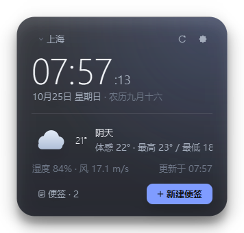
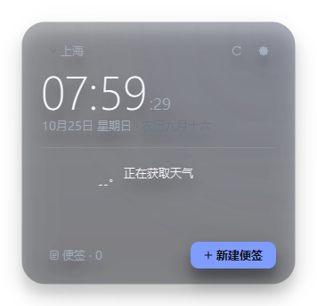
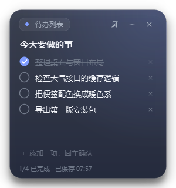
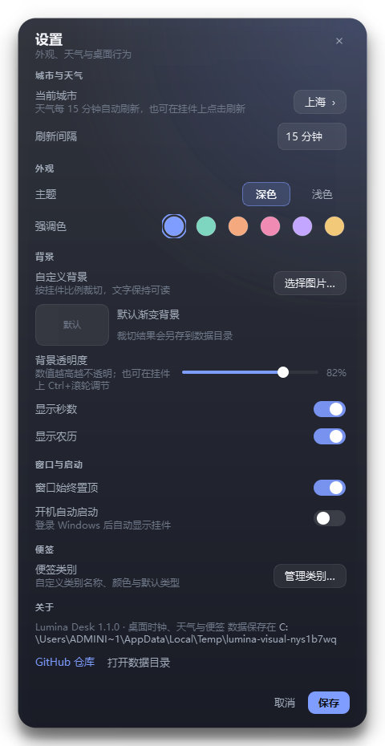
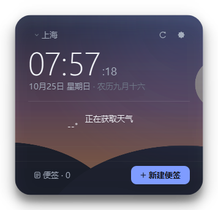
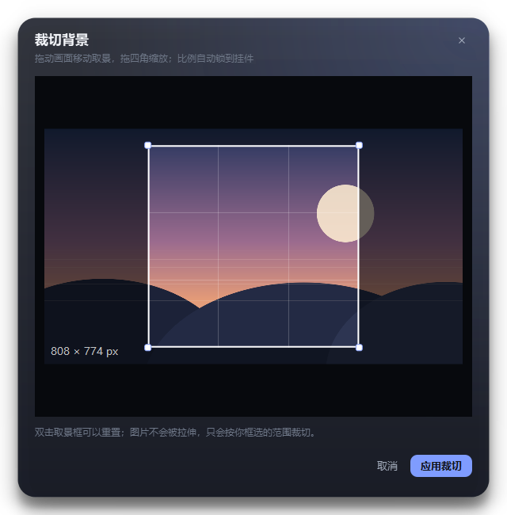

# Lumina Desk

<p align="center">
  
</p>

<p align="center">
  <b>放在桌面一角的时钟、天气与便签。</b><br>
  无边框半透明卡片 · 便签自动保存 · 数据全部留在本地
</p>

<p align="center">
  <a href="https://github.com/LilSeven/LuminaDesk/releases/latest"></a>
  
  
</p>

---

## 功能

### 桌面挂件

- 时间、日期、星期与农历，可选 24 小时制 / 显示秒
- 当前天气、体感温度、最高最低温、湿度、风速、更新时间
- 城市搜索（Open-Meteo 地理编码），天气每 5–60 分钟自动刷新，失败时回退到缓存
- **背景透明度 25%–100% 可调**：设置里的滑块，或把鼠标放在挂件上 `Ctrl + 滚轮`
- **自定义背景**：选择任意图片，按挂件当前比例自由框选、拖拽缩放；裁切结果存到本地，原图不会被修改
- 深色 / 浅色主题，6 种强调色
- 始终置顶、开机自启、托盘常驻、单实例运行

### 桌面便签

- 自由拖动、缩放，位置和大小会被记住
- 类别由用户维护：名称、颜色、默认类型都可以改，默认提供「备忘录 / 待办列表 / 灵感 / 收集箱」
- 两种内容形态：普通文本，或带勾选、进度统计的待办清单；可在「更多」菜单里互相转换
- 置顶、自动保存（约 0.5 秒防抖）、重启后恢复打开的便签
- 便签中心：搜索标题 / 正文 / 待办项，按类别筛选

## 截图

| 桌面挂件 | 透明度 38% |
| --- | --- |
|  |  |

| 待办便签 | 设置 |
| --- | --- |
|  |  |

| 自定义背景 | 裁切不匹配的比例 |
| --- | --- |
|  |  |

## 下载与运行

1. 打开 [Releases](https://github.com/LilSeven/LuminaDesk/releases/latest)，下载 `LuminaDesk.exe`。
2. 双击运行即可，无需安装，也无需单独安装 Python。

系统要求：Windows 10 / 11 x64。程序未做商业代码签名，首次运行时 SmartScreen 可能提示「未知发布者」，选择「更多信息 → 仍要运行」即可。

## 使用提示

- 拖动挂件空白处可以移动位置，位置会自动保存。
- 双击挂件，或点右下角「新建便签」，快速记一条。
- 右键挂件：新建便签、便签管理、设置、隐藏 / 退出。
- 关闭便签窗口只是隐藏，内容仍在；在便签中心可以重新打开。
- 托盘图标单击可重新显示挂件。
- 所有数据都在 `%APPDATA%\LuminaDesk\`：

  | 文件 | 内容 |
  | --- | --- |
  | `config.json` | 城市、透明度、主题、窗口位置、背景文件名等 |
  | `notes.json` | 便签、待办项与自定义类别 |
  | `background-*.png` | 裁切后的自定义背景 |
  | `weather_cache.json` | 最近一次天气缓存 |
  | `app.log` | 仅在异常时写入的崩溃日志 |

联网只用于向 [Open-Meteo](https://open-meteo.com/) 请求天气与城市搜索结果，没有账号、没有遥测，便签内容不会离开本机。

## 从源码运行

```powershell
python -m pip install -r requirements.txt
python main.py
```

需要 Python 3.10+。开发模式下的数据目录可以用环境变量覆盖：

```powershell
$env:LUMINA_DATA_DIR = "$env:TEMP\lumina-dev"
python main.py
```

## 打包 exe

```powershell
python -m pip install pyinstaller
python tools\make_assets.py          # 重新生成 assets\icon.ico（可选）
python -m PyInstaller LuminaDesk.spec --noconfirm
```

产物为 `dist\LuminaDesk.exe`（单文件，约 46 MB）。

## 项目结构

```
LuminaDesk/
├─ main.py                 入口、单实例、异常日志
├─ app/
│  ├─ application.py       控制器：窗口、天气、设置、托盘接线
│  ├─ config.py            配置读写
│  ├─ notes.py             便签数据模型与存储
│  ├─ weather.py           Open-Meteo 客户端与缓存
│  ├─ theme.py             深 / 浅色调色板与全局 QSS
│  ├─ settings.py          设置、城市搜索与背景裁切入口
│  ├─ background.py        自定义背景的读取、保存与路径管理
│  ├─ image_crop.py        按比例自由裁切的取景对话框
│  ├─ note_manager.py      便签中心
│  ├─ category_dialog.py   类别管理
│  ├─ dialogs.py           通用玻璃对话框
│  ├─ tray.py              托盘菜单
│  ├─ autostart.py         HKCU 开机启动
│  ├─ single_instance.py   QLocalServer 单实例
│  └─ ui/                  挂件、便签窗口、矢量图标、基础控件
├─ tools/
│  ├─ smoke_test.py        启动全界面并截图
│  ├─ background_test.py   自定义背景与裁切流程截图
│  └─ make_assets.py       生成应用图标
└─ LuminaDesk.spec         PyInstaller 配置
```

## 技术栈

Python 3.10 · PySide6（Qt 6）· Open-Meteo API · PyInstaller

## License

[MIT](LICENSE)
